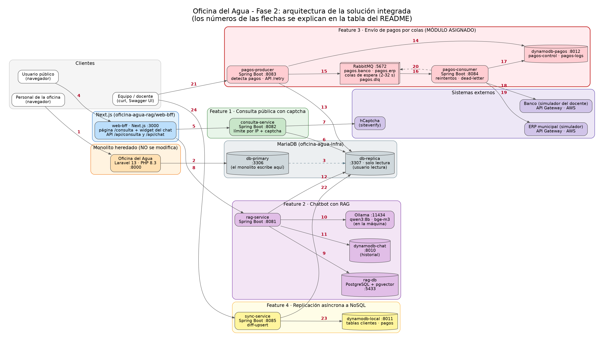

Nombre: Gustavo Adolfo Godoy Barrera  
Carnet: 0905-19-9068  
Repositorio: https://github.com/aquatech-umg/oficina-agua-pagos  
Modulo asignado: Envío de pagos a sistemas externos por colas

# oficina-agua-pagos

Feature 3 de la Fase 2 de la Oficina del Agua: cada pago que se registra en el monolito se entrega al **banco** y al **ERP municipal** mediante **RabbitMQ**, con reintentos para los fallos transitorios y **sin duplicar pagos**.

El monolito heredado (Laravel) **no se modifica**. Este repositorio contiene dos servicios Spring Boot independientes (`pagos-producer` y `pagos-consumer`) que *leen* los pagos desde la réplica de solo lectura y llevan su propio control de lo transmitido en DynamoDB.

> Este README tiene dos partes: la **arquitectura de toda la solución integrada** (secciones 1 a 3) y la **documentación detallada de mi módulo** (sección 4). Las secciones 5 a 7 cubren seguridad, estructura del repositorio y cómo se elaboró la documentación.

## Contenido

1. [Arquitectura de la solución integrada](#1-arquitectura-de-la-solución-integrada)
2. [Componentes](#2-componentes)
3. [Cómo se ejecuta la solución completa](#3-cómo-se-ejecuta-la-solución-completa)
4. [Módulo asignado: envío de pagos por colas](#4-módulo-asignado-envío-de-pagos-por-colas)
5. [Seguridad de la información](#5-seguridad-de-la-información)
6. [Estructura del repositorio y flujo de trabajo](#6-estructura-del-repositorio-y-flujo-de-trabajo)
7. [Cómo se elaboró esta documentación](#7-cómo-se-elaboró-esta-documentación)

---

## 1. Arquitectura de la solución integrada

La solución de la Fase 2 está formada por el **monolito heredado** y **cuatro features nuevas** que viven en repositorios propios de la organización `aquatech-umg`:

| Pieza | Repositorio | Qué es |
|---|---|---|
| Monolito heredado | `MCambara707/oficina-agua` | Sistema Laravel 13 (PHP 8.3) de gestión de agua. Sigue intacto. |
| Infraestructura | `oficina-agua-infra` | MariaDB con base principal y réplica, datos de prueba y el `docker-compose.equipo.yml` que levanta toda la infraestructura. |
| Feature 1: consulta pública con captcha | `oficina-agua-consulta` | `consulta-service` (estado de cuenta público). |
| Feature 2: chatbot con RAG | `oficina-agua-rag` | `rag-service` (RAG con Ollama y pgvector) y `web-bff` (Next.js: página pública y widget del chat). |
| **Feature 3: envío de pagos por colas** | **`oficina-agua-pagos` (este repo)** | `pagos-producer`, `pagos-consumer`, RabbitMQ y DynamoDB de control. |
| Feature 4: replicación asíncrona a NoSQL | `oficina-agua-replicacion` | `sync-service`, que copia clientes y pagos de la réplica a DynamoDB. |

### Diagrama



Versión vectorial: [`docs/arquitectura.svg`](docs/arquitectura.svg) (fuente Graphviz: [`docs/arquitectura.dot`](docs/arquitectura.dot)).

### Idea central

**El monolito escribe en la base principal; MariaDB copia cada cambio a una réplica de solo lectura; todos los servicios nuevos leen solo de esa réplica.** Así ninguna feature toca el monolito ni su base de datos, y cada una guarda su propio estado en su propia base (DynamoDB o PostgreSQL).

### Qué representa cada flecha

| N.º | Origen → destino | Qué representa |
|---|---|---|
| 1 | Personal → Monolito | Uso normal del sistema (HTTP, puerto 8000): clientes, contadores, lecturas, recibos y pagos. |
| 2 | Monolito → `db-primary` | El monolito es el único que escribe en la base principal. |
| 3 | `db-primary` → `db-replica` | Replicación de MariaDB (asíncrona, línea punteada). La réplica solo admite lectura. |
| 4 | Usuario público → `web-bff` | Página pública `/consulta` y widget del chat (Next.js). |
| 5 | `web-bff` → `consulta-service` | `GET /api/consulta`: el BFF reenvía el token del captcha y la IP real del visitante. |
| 6 | `consulta-service` → `db-replica` | Lectura del estado de cuenta (usuario de solo lectura). |
| 7 | `consulta-service` → hCaptcha | Verificación del token del captcha (HTTPS, `siteverify`). |
| 8 | `web-bff` → `rag-service` | `POST /api/chat`: el navegador nunca habla directo con el servicio del chatbot. |
| 9 | `rag-service` → `rag-db` | Búsqueda por similitud en PostgreSQL con pgvector. |
| 10 | `rag-service` → Ollama | Embeddings (`bge-m3`) y generación de la respuesta (`qwen3:8b`). |
| 11 | `rag-service` → `dynamodb-chat` | Historial de conversaciones. |
| 12 | `rag-service` → `db-replica` | Lectura periódica (cada 2 minutos) de los datos públicos: tarifas, servicios, formas de pago, avisos y preguntas frecuentes. |
| 13 | `pagos-producer` → `db-replica` | Lectura de los pagos nuevos (**mi módulo**). |
| 14 | `pagos-producer` → `dynamodb-pagos` | Creación y reclamo de los ítems de control (`pagos-control`). |
| 15 | `pagos-producer` → RabbitMQ | Publicación de un mensaje por destino (`pagos.banco`, `pagos.erp`). |
| 16 | RabbitMQ → `pagos-consumer` | Entrega del mensaje con ack manual. |
| 17 | `pagos-consumer` → `dynamodb-pagos` | Lectura del ítem, registro de cada intento (`pagos-logs`) y estado final. |
| 18 | `pagos-consumer` → Banco | `POST /bank/v1/payments` con `Idempotency-Key` y `x-api-key`. |
| 19 | `pagos-consumer` → ERP | `POST /erp/v1/pagos` con `x-api-key`. |
| 20 | `pagos-consumer` → RabbitMQ | Colas de espera con retardo creciente y `pagos.dlq` (línea punteada). |
| 21 | Equipo/docente → `pagos-producer` | `GET` del estado de un pago y `POST /retry` (Swagger UI o curl). |
| 22 | `sync-service` → `db-replica` | Lectura de clientes y pagos. |
| 23 | `sync-service` → `dynamodb-local` | Copia a NoSQL solo de lo que cambió (diff-upsert). |
| 24 | Equipo/docente → `sync-service` | `POST /api/sync/resumen` inicia un trabajo; `GET /api/sync/jobs/{id}` muestra el avance. |

## 2. Componentes

| Componente | Tecnología | Puerto | Función |
|---|---|---|---|
| Monolito | Laravel 13, PHP 8.3 | 8000 | Sistema heredado. Escribe en `db-primary`. |
| `db-primary` | MariaDB | 3306 | Base principal del monolito (esquema `oficina_agua`). |
| `db-replica` | MariaDB | 3307 | Réplica de solo lectura; usuario `lectura`. |
| `web-bff` | Next.js | 3000 | Página pública `/consulta`, widget del chat y rutas `/api/consulta` y `/api/chat`. |
| `consulta-service` | Spring Boot | 8082 | Estado de cuenta público por código de contador; valida hCaptcha y limita por IP (30 peticiones por minuto). |
| `rag-service` | Spring Boot | 8081 | Chatbot RAG: busca fragmentos relevantes y los pasa al modelo. |
| `rag-db` | PostgreSQL + pgvector | 5433 | Vectores del conocimiento del chatbot. |
| `dynamodb-chat` | DynamoDB Local | 8010 | Historial del chat. |
| Ollama | Ollama | 11434 | Modelos `qwen3:8b` y `bge-m3`; corre en la máquina, fuera de Docker. |
| `pagos-producer` | Spring Boot | 8083 | Detecta pagos nuevos, los prepara y publica; expone la API de estado y reintento. |
| `pagos-consumer` | Spring Boot | 8084 | Entrega cada pago al banco y al ERP; reintenta y registra. |
| RabbitMQ | RabbitMQ 4 | 5672 / 15672 | Colas de pagos, colas de espera y `pagos.dlq`. |
| `dynamodb-pagos` | DynamoDB Local | 8012 | Tablas `pagos-control` y `pagos-logs`. |
| `sync-service` | Spring Boot | 8085 | Copia clientes y pagos de la réplica a DynamoDB. |
| `dynamodb-local` | DynamoDB Local | 8011 | Tablas `clientes` y `pagos` de la replicación. |
| hCaptcha | Servicio externo | – | Verifica que el visitante no es un robot. |
| Banco y ERP | Simuladores del docente (API Gateway en AWS) | – | Sistemas externos que reciben los pagos. |

**Nota sobre la nube.** El repositorio `oficina-agua-consulta` documenta un despliegue de `consulta-service` en AWS ECS Fargate (`docs/despliegue-ecs-fargate.md`), pero ese documento indica que **no se ejecutó** por restricciones de las cuentas de AWS. Por eso no aparece en el diagrama: la solución integrada se ejecuta localmente con Docker Compose y los servicios del equipo.

## 3. Cómo se ejecuta la solución completa

El procedimiento implementado está en `oficina-agua-infra/docker-compose.equipo.yml`, que incluye los compose de los repositorios de infraestructura, RAG, pagos y replicación.

**Requisitos:** Docker Desktop, Git, JDK 21, Node 22, PHP 8.3 con Composer 2 y (opcional, solo para el chatbot) Ollama.

**1. Clonar los repositorios en la misma carpeta**

```bash
git clone https://github.com/aquatech-umg/oficina-agua-infra.git
git clone https://github.com/aquatech-umg/oficina-agua-pagos.git
git clone https://github.com/aquatech-umg/oficina-agua-replicacion.git
git clone https://github.com/aquatech-umg/oficina-agua-consulta.git
git clone https://github.com/aquatech-umg/oficina-agua-rag.git
git clone https://github.com/MCambara707/oficina-agua.git
```

**2. Crear los `.env` a partir de los ejemplos** (cada repo tiene su `.env.example`; los `.env` reales no se suben a Git):

```bash
cp oficina-agua-infra/.env.example oficina-agua-infra/.env
cp oficina-agua-pagos/.env.example oficina-agua-pagos/.env
cp oficina-agua-consulta/.env.example oficina-agua-consulta/.env
cp oficina-agua-rag/web-bff/.env.example oficina-agua-rag/web-bff/.env.local
```

Define contraseñas propias en esos archivos y usa la **misma clave de lectura** (`DB_LECTURA_PASSWORD`) en todos los servicios que leen la réplica.

**3. Levantar toda la infraestructura** (bases, réplica, DynamoDB, RabbitMQ):

```bash
cd oficina-agua-infra
docker compose -f docker-compose.equipo.yml up -d
docker compose -f docker-compose.equipo.yml ps
```

**4. Cargar los datos de prueba** (una sola vez; 500 clientes, 600 contadores, recibos y unos 37 mil pagos):

```bash
docker exec -i db-primary mariadb -uroot oficina_agua < datos-prueba/datos-prueba.sql
```

(En PowerShell: `Get-Content .\datos-prueba\datos-prueba.sql -Raw | docker exec -i db-primary mariadb -uroot oficina_agua`).

**5. Monolito** (el esquema ya lo cargó la infraestructura, no hay migraciones):

```bash
cd ../oficina-agua
composer install && cp .env.example .env && php artisan key:generate
npm install && npm run build && php artisan storage:link
php artisan serve        # http://localhost:8000
```

Los usuarios de los datos de prueba no pueden iniciar sesión; para entrar se crea un administrador con `php artisan tinker`.

**6. Servicios Java y Next.js** (una terminal cada uno, desde la carpeta del servicio):

| Servicio | Carpeta | Comando |
|---|---|---|
| pagos-producer | `oficina-agua-pagos/pagos-producer` | `./mvnw spring-boot:run` |
| pagos-consumer | `oficina-agua-pagos/pagos-consumer` | `./mvnw spring-boot:run` |
| consulta-service | `oficina-agua-consulta/consulta-service` | `./mvnw spring-boot:run` |
| sync-service | `oficina-agua-replicacion/sync-service` | `./mvnw spring-boot:run` |
| rag-service | `oficina-agua-rag/rag-service` | `./mvnw spring-boot:run` |
| web-bff | `oficina-agua-rag/web-bff` | `npm install && npm run dev` |

(En Windows se usa `mvnw.cmd`.) Cada servicio lee sus credenciales de **variables de entorno**; la sección 4.6 lista las de mis servicios. Para el chatbot hay que tener Ollama con los modelos descargados (`ollama pull qwen3:8b` y `ollama pull bge-m3`).

---

## 4. Módulo asignado: envío de pagos por colas

### 4.1 Funcionalidad y objetivo

**Problema del negocio.** Cuando la Oficina del Agua cobra un recibo, ese pago también debe quedar registrado en el banco y en el ERP municipal. Esos sistemas externos fallan a veces (tiempos de espera, errores 5xx, límites de uso), y un reintento ingenuo podría **registrar el mismo cobro dos veces**. Además, el monolito no se puede modificar, así que no es posible enviar los pagos desde ahí.

**Qué construí.** Un flujo asíncrono con dos servicios y una cola:

1. **`pagos-producer`** revisa cada 10 segundos la réplica, detecta los pagos nuevos y crea, por cada uno, **dos ítems de control** en DynamoDB (uno para el banco y otro para el ERP). Cada ítem guarda el **payload ya armado** según el contrato de su destino. Luego "reclama" los ítems pendientes y publica **un mensaje por destino** en RabbitMQ.
2. **`pagos-consumer`** toma cada mensaje, lee su ítem, envía el payload al destino con el cliente HTTP generado desde el contrato del docente y **registra cada intento**. Según la respuesta, el pago queda `ENVIADO`, espera para reintentarse, o termina en la cola de errores `pagos.dlq` con estado `FALLIDO`.
3. Un pago `FALLIDO` se puede volver a encolar con **`POST /api/v1/payments/transmissions/{paymentId}/retry`**.

**Cómo funciona un pago, paso a paso**

```
Réplica ─► producer ─► pagos-control (PENDIENTE) ─► EN_COLA + mensaje en RabbitMQ
                                                          │
                                                      consumer ──► Banco / ERP
                          201 o 409 duplicado ─► ENVIADO
                          fallo transitorio   ─► cola de espera (2, 4, 8, 16 s) ─► vuelve a la cola
                          fallo definitivo o 5 intentos ─► pagos.dlq + FALLIDO ─► POST /retry
```

### 4.2 Integración y responsabilidades

| Con quién se comunica | Cómo | Por qué esa frontera |
|---|---|---|
| Monolito | **No hay comunicación directa.** | El monolito heredado no se modifica; se desacopla leyendo solo la réplica. |
| Réplica MariaDB (`db-replica`) | Solo lectura (usuario `lectura`, conexión marcada como read-only). | La réplica no admite escrituras; así es imposible dañar los datos del monolito. |
| DynamoDB (`dynamodb-pagos`) | Tablas `pagos-control` y `pagos-logs`. | El estado de la entrega es de este módulo y no puede vivir en la base del monolito. |
| RabbitMQ | Colas durables, mensajes persistentes, publisher confirms y ack manual. | Separa "detectar" de "entregar": el producer no espera a los sistemas externos. |
| Banco y ERP | HTTP con clientes Feign **generados desde los contratos del docente** (sin modificarlos). | El contrato manda (contract-first); URLs y llaves van en variables de entorno. |

**Lo que este módulo no hace:** no escribe en MariaDB ni en el monolito, no guarda credenciales en el repositorio y no expone ninguna clave al navegador. Las operaciones `listTransmissions` y `dispatchPendingPayments` del contrato responden `501`, y la recuperación de ítems atascados del diseño no está implementada.

### 4.3 Decisiones técnicas

**1. El control de entrega vive en DynamoDB, no en MySQL.**
La réplica es de solo lectura y la base principal pertenece al monolito, así que no había dónde guardar el estado "ya enviado" sin tocarlos. DynamoDB resuelve eso y además ofrece **escrituras condicionales atómicas** (la base de la idempotencia) y un índice secundario por estado para encontrar rápido los pendientes. El detalle está en [`docs/diseno-control-pagos.md`](docs/diseno-control-pagos.md).

**2. Idempotencia en varias capas, porque RabbitMQ entrega "al menos una vez".**
El mismo mensaje puede llegar dos veces, y el mismo pago puede reintentarse. Para que eso nunca duplique un cobro:
- La **llave es estable** y se deriva del pago (`EQA-000123`): todos los reintentos usan la misma.
- El **payload se guarda una sola vez** (`PutItem` condicional) y los reintentos reenvían exactamente el mismo cuerpo.
- Reclamar un ítem (`PENDIENTE → EN_COLA`) es una **escritura condicional**: si dos ciclos coinciden, solo uno gana.
- Antes de llamar, el consumer **descarta** lo que ya está `ENVIADO` o `FALLIDO` y revisa en `pagos-logs` si ya hubo un éxito.
- El banco y el ERP responden `409` cuando ya tenían el pago, y eso se trata como **éxito**.

**3. Reintentos con colas de espera por escalón, no con `sleep` ni con un TTL distinto por mensaje.**
Esperar dentro del consumer ocuparía hilos y se perdería al reiniciar. Usar un TTL diferente por mensaje en una sola cola de espera tiene un defecto conocido: RabbitMQ solo expira el mensaje que está al frente, así que uno de 16 s retrasaría a uno de 2 s que está detrás. La solución fue **una cola por escalón** (`pagos.banco.retry.2s`, `.4s`, `.8s`, `.16s`, `.32s`, y lo mismo para el ERP), cada una con su TTL fijo y con dead-letter hacia la cola principal: al vencer, RabbitMQ devuelve el mensaje solo. Las esperas son 2, 4, 8 y 16 s (hasta 5 intentos); si el destino manda `Retry-After`, se usa el escalón que lo cubre. Las colas principales no cambian de argumentos, para no chocar con las que declara el producer.

**4. Ack manual y confirmaciones del publicador: no se pierde un pago.**
El consumer confirma el mensaje original **solo después** de registrar el resultado y de que RabbitMQ confirmó la publicación en la cola de espera o en `pagos.dlq`. Si algo falla antes, el mensaje vuelve a la cola.

**5. Contract-first.**
Las interfaces de la API del producer y los clientes del banco y del ERP se **generan** con `openapi-generator-maven-plugin` a partir de los YAML; nunca se escriben a mano. Los payloads que arma el producer se validaron contra los esquemas reales de esos contratos.

**6. El consumer marca `ENVIADO` directamente.**
El diseño inicial proponía un proceso aparte (Lambda en AWS) que marcara los pagos como enviados. Lo simplifiqué: el consumer hace la transición `EN_COLA → ENVIADO` con una escritura condicional justo después de registrar el éxito. Es más simple de operar y mantiene la garantía, porque la transición es atómica.

### 4.4 Datos, colas y API

**Estados de cada ítem de `pagos-control`** (una fila por pago y destino, p. ej. `EQA-000123#BANCO`):

| Estado | Significado | Quién lo escribe |
|---|---|---|
| `PENDIENTE` | Creado, falta publicarlo. | Producer (o `POST /retry`) |
| `EN_COLA` | Publicado; esperando resultado. | Producer |
| `ENVIADO` | El destino lo aceptó (201 o 409 de duplicado). | Consumer |
| `FALLIDO` | Rechazo definitivo o reintentos agotados. Solo `POST /retry` lo saca de aquí. | Consumer |

`pagos-logs` guarda **una fila por intento** (solo se agregan): resultado, código HTTP, duración, comprobante y el cuerpo del error.

**Qué se hace con cada respuesta del destino:**

| Respuesta | Acción |
|---|---|
| 201 | Entregado: `ENVIADO` y se guarda el comprobante. |
| 409 `DUPLICATE_PAYMENT` / `DOCUMENTO_DUPLICADO` | Ya estaba entregado: se trata como éxito y se guarda el comprobante original que devuelve el destino. |
| 409 `IDEMPOTENCY_KEY_REUSED` / `DOCUMENTO_REUTILIZADO` | Error del productor: `pagos.dlq` y `FALLIDO`, sin reintentar. |
| 429, 500, 502, 503, 504, timeout | Reintento con espera creciente (respeta `Retry-After`). |
| 400, 403, 422 | Sin reintento: `pagos.dlq` y `FALLIDO`. |

`pagos.dlq` es el registro de los pagos que se rindieron. `POST /retry` los reenvía, pero no borra el mensaje original de esa cola; se puede purgar desde RabbitMQ.

**API del producer** (contrato `pagos-producer/src/main/resources/openapi/payments-api.yaml`, puerto 8083):

| Método | Ruta | Estado |
|---|---|---|
| GET | `/api/v1/payments/transmissions/{paymentId}` | Implementado: estado del pago en el banco y el ERP. |
| POST | `/api/v1/payments/transmissions/{paymentId}/retry` | Implementado: 202, 404 o 409. Cuerpo opcional `{"destination":"BANK" \| "ERP" \| "BOTH"}`. |
| GET | `/api/v1/payments/transmissions` | `501` (fuera de este sprint). |
| POST | `/api/v1/payments/dispatch` | `501` (fuera de este sprint). |

Swagger UI: `http://localhost:8083/swagger-ui.html`.

### 4.5 Instrucciones para probar el módulo

**Requisitos previos:** JDK 21, Docker Desktop y las llaves `x-api-key` del banco y del ERP que entrega el docente. Para probar solo este módulo no hace falta levantar el monolito ni los demás módulos; bastan la base con su réplica (repositorio de infraestructura) y el RabbitMQ y DynamoDB de este repositorio:

```bash
cd oficina-agua-infra && docker compose up -d && cd ..      # MariaDB principal y réplica (usuario lectura)
# cargar los datos de prueba una sola vez (sección 3, paso 4)
cd oficina-agua-pagos && docker compose up -d                # RabbitMQ y DynamoDB de pagos
```

Para **repetir las pruebas desde cero** sin tocar la réplica ni sus datos: `docker compose down -v && docker compose up -d` dentro de `oficina-agua-pagos` (borra solo RabbitMQ y DynamoDB de pagos).

**Variables de entorno.** En cada terminal (PowerShell: `$env:NOMBRE="valor"`; bash: `export NOMBRE=valor`):

| Servicio | Variable | Valor / descripción |
|---|---|---|
| producer | `DB_REPLICA_HOST`, `DB_REPLICA_PORT` | `localhost`, `3307` |
| producer | `DB_LECTURA_USER`, `DB_LECTURA_PASSWORD` | `lectura` y la clave definida en `oficina-agua-infra/.env` |
| producer | `TEAM_CODE` | `EQUIPO_A` (debe coincidir con la llave) |
| producer | `PAGOS_DESDE` | `2026-09-19` (**importante**: si no se define, arranca en 1970 y procesa los ~37 mil pagos) |
| producer y consumer | `DYNAMODB_ENDPOINT` | `http://localhost:8012` |
| producer y consumer | `AWS_REGION`, `AWS_ACCESS_KEY_ID`, `AWS_SECRET_ACCESS_KEY` | `us-east-1`, `local`, `local` (DynamoDB Local) |
| producer y consumer | `RABBITMQ_USER`, `RABBITMQ_PASSWORD` | Los de `oficina-agua-pagos/.env` |
| consumer | `BANK_BASE_URL`, `ERP_BASE_URL` | URL base de los simuladores del docente |
| consumer | `BANK_API_KEY`, `ERP_API_KEY` | Llave `x-api-key` entregada por el docente |

**Prueba 1: flujo normal**

1. Arranca el producer: `cd pagos-producer && ./mvnw spring-boot:run`.
   *Esperado:* en unos 10 s la consola muestra `Ciclo del producer: N ítems creados, N mensajes publicados` (N = dos por cada pago desde `PAGOS_DESDE`), y `http://localhost:8083/api/salud` responde.
2. Revisa DynamoDB (requiere AWS CLI con credenciales `local`):
   ```bash
   aws dynamodb scan --table-name pagos-control --endpoint-url http://localhost:8012 \
     --query "Items[].[pagoDestino.S,estado.S,intentos.N]" --output text
   ```
   *Esperado:* dos filas por pago (`EQA-000001#BANCO` y `EQA-000001#ERP`) en `EN_COLA`, más una fila `_CURSOR`. En RabbitMQ (`http://localhost:15672`, pestaña *Queues*), `pagos.banco` y `pagos.erp` tienen un mensaje por pago.
3. **Idempotencia del producer:** detén y vuelve a arrancar el producer. *Esperado:* no crea ítems ni mensajes nuevos.
4. Arranca el consumer: `cd pagos-consumer && ./mvnw spring-boot:run`.
   *Esperado:* una línea por mensaje, `EQA-000001#BANCO intento 1 -> EXITOSO (HTTP 201)` (o `EXITOSO_DUPLICADO (HTTP 409)` si ya se había enviado), y en RabbitMQ aparecen las colas de espera y `pagos.dlq`.
5. Repite el `scan` de `pagos-control`. *Esperado:* todos los pagos en `ENVIADO`. La tabla `pagos-logs` tiene una fila por intento con el comprobante (`referenciaExterna`).

**Prueba 2: fallo transitorio hasta dead-letter**

1. Detén ambos servicios y reinicia el estado de pagos: `docker compose down -v && docker compose up -d` dentro de `oficina-agua-pagos` (la réplica y sus datos no se tocan).
2. Define `BANK_SIMULATION_SCENARIO=ERROR_503` en la terminal del consumer; arranca primero el producer y luego el consumer.
3. *Esperado (≈30 s):* para cada pago del banco, `falló (HTTP_503); reintento 2 de 5 en 2 s`, luego 4, 8 y 16 s, y al quinto intento `-> pagos.dlq y FALLIDO (REINTENTOS_AGOTADOS)`. Los pagos del banco quedan `FALLIDO` con 5 intentos, `pagos.dlq` tiene un mensaje por pago, y los del ERP quedan `ENVIADO`.
4. Consulta el estado de un pago: `curl http://localhost:8083/api/v1/payments/transmissions/1` → `bank` en `FAILED`, `erp` en `SENT`.

**Prueba 3: reintento manual**

1. Reinicia el consumer **sin** `BANK_SIMULATION_SCENARIO` (el producer sigue corriendo).
2. `curl -i -X POST http://localhost:8083/api/v1/payments/transmissions/1/retry`
   *Esperado:* `202` con el banco en `QUEUED`; el consumer registra un intento nuevo con éxito y el pago pasa a `ENVIADO`.
3. Repite el mismo `POST`: `409` (ya no hay nada en `FAILED`). Con un id inexistente (`99999999`): `404`.

**Prueba 4: con el monolito** (opcional, requiere los pasos 5 y 6 de la sección 3)

1. En el monolito (`http://localhost:8000`) inicia sesión y registra el pago de un recibo pendiente.
2. *Esperado:* en menos de 10 s el producer detecta el pago nuevo, el consumer lo entrega, y `GET /api/v1/payments/transmissions/{id}` (con el id del pago nuevo) muestra banco y ERP en `SENT`.

**Prueba 5: pagos fallidos, guiada (AQ-142)**

En el producer define `PAGOS_EQUIPO=EQA-AQT` y `PAGOS_DESDE=<fecha de hoy>`: así solo se procesan los pagos nuevos y las llaves (`EQA-AQT-0xxxxx`) no chocan con pruebas anteriores. Para cada caso, registra un pago nuevo en el monolito.

- **Caso 1, LOST_ACK (reintento sin duplicar).** Consumer con `BANK_SIMULATION_SCENARIO=LOST_ACK`.
  *Esperado:* el intento 1 da timeout, el mensaje pasa por `pagos.banco.retry.2s` y el intento 2 recibe `409` de duplicado. El banco queda `SENT` con `attempts: 2` y el comprobante original en `externalReference`; en el banco hay una sola referencia (`GET /bank/v1/payments/{llave}` con la `x-api-key`).
- **Caso 2, ERROR_500 (dead-letter y reenvío manual).** Consumer con `BANK_SIMULATION_SCENARIO=ERROR_500`.
  *Esperado:* 5 intentos con esperas de 2, 4, 8 y 16 s (colas `pagos.banco.retry.*`; la de 32 s solo se usa si el destino manda `Retry-After`), el mensaje cae en `pagos.dlq` y el banco queda `FAILED` con `lastError` del tipo `HTTP_500: {...}`. Reinicia el consumer **sin** el escenario y llama a `POST /api/v1/payments/transmissions/{id}/retry`: responde `202`, el pago se envía y queda `SENT` con `attempts: 6` (5 fallidos y 1 exitoso) y una referencia `BNK-...`. El mensaje viejo sigue en `pagos.dlq`; al purgarlo en RabbitMQ queda en 0.

*Evidencia:* las colas de RabbitMQ en cada paso, el log del consumer con los intentos y `GET /transmissions/{id}` antes y después del reintento. Al terminar, quita las variables `BANK_SIMULATION_SCENARIO` y `ERP_SIMULATION_SCENARIO`. El docente puede desactivar los escenarios el día de la demo, por eso esta prueba se graba antes.

**Pruebas automáticas:** `./mvnw test` en `pagos-producer` y en `pagos-consumer`.

### 4.6 Variables de configuración

**Consumer**

| Variable | Para qué |
|---|---|
| `BANK_BASE_URL`, `ERP_BASE_URL` | URL base de cada simulador. |
| `BANK_API_KEY`, `ERP_API_KEY` | Llave `x-api-key` (la que exige el contrato). Vacía: el header no se envía. |
| `SIMULADOR_USUARIO`, `SIMULADOR_PASSWORD` | Alternativa opcional: `Authorization: Basic`. Vacías: no se envía. |
| `BANK_SIMULATION_SCENARIO`, `ERP_SIMULATION_SCENARIO` | Solo pruebas: fuerza un escenario del simulador (`SUCCESS`, `LOST_ACK`, `ERROR_503`, `TIMEOUT`, ...). |

**Producer**

| Variable | Para qué |
|---|---|
| `PAGOS_DESDE` | Fecha mínima (`yyyy-MM-dd`) de `fecha_pago` que se toma de la réplica. **Si no se define, arranca en 1970: sin filtro, manda todos los pagos (~37 mil).** Vacía equivale a no definirla. |
| `TEAM_CODE` | Código de equipo de los contratos (`EQUIPO_A`...); debe coincidir con la API key. |
| `PAGOS_EQUIPO` | Prefijo de la llave de idempotencia (por defecto `EQA`; queda `EQA-000123`). |
| `DB_REPLICA_HOST`, `DB_REPLICA_PORT`, `DB_REPLICA_NAME` | Réplica de solo lectura (por defecto `localhost`, `3307`, `oficina_agua`). |
| `DB_LECTURA_USER`, `DB_LECTURA_PASSWORD` | Usuario de solo lectura de la réplica. |

### 4.7 Documentos del módulo

- [`docs/diseno-control-pagos.md`](docs/diseno-control-pagos.md): diseño del control de pagos (tablas, estados, idempotencia, reintentos).
- [`docs/feign-clientes.md`](docs/feign-clientes.md): cómo se generan y usan los clientes del banco y del ERP.
- Contratos: `pagos-producer/.../openapi/payments-api.yaml` (propio) y `pagos-consumer/.../openapi/bank-payments-api.yaml`, `erp-payments-api.yaml` (del docente, sin modificar).
- `pruebas-simuladores/`: cuerpos de ejemplo para probar los simuladores con curl.

---

## 5. Seguridad de la información

- **Ninguna credencial está en el repositorio.** Las URLs, llaves (`BANK_API_KEY`, `ERP_API_KEY`) y claves de bases de datos se leen de **variables de entorno**. Los archivos `.env` reales están en `.gitignore`; el repo solo trae `.env.example`, con valores vacíos o de ejemplo (`changeme`, `local` para DynamoDB Local).
- Los `application.yaml` solo tienen referencias del tipo `${BANK_API_KEY:}`, nunca valores.
- **Historial de Git revisado:** nunca se versionó un archivo `.env`, y no hay llaves, tokens ni contraseñas en ningún commit (se comprobó con `git log --all -S<cadena>` y buscando asignaciones de `password`, `key`, `token` y `secret`). La única cadena parecida a un token es una constante de una prueba unitaria que codifica un usuario de ejemplo inventado.
- Para repetir la verificación:
  ```bash
  git log --all --name-only --format= | grep -i -E "\.env$|secret|\.pem|\.key$"
  git log --all -p --format= | grep -i -E "(password|secret|api[_-]?key|token)[A-Za-z_]*\s*[:=]\s*['\"]?[A-Za-z0-9/+_.-]{6,}"
  ```
- Las llaves de los modelos de IA y de los simuladores nunca llegan al navegador: el navegador solo habla con Next.js, y este con los servicios.

## 6. Estructura del repositorio y flujo de trabajo

```
oficina-agua-pagos/
├── README.md
├── docker-compose.yml            RabbitMQ y DynamoDB Local (pagos-control y pagos-logs)
├── .env.example                  Variables de ejemplo (copiar a .env)
├── docs/
│   ├── arquitectura.png / .svg / .dot   Diagrama de la solución integrada
│   ├── diseno-control-pagos.md          Diseño del control de pagos
│   └── feign-clientes.md                Clientes del banco y del ERP
├── pruebas-simuladores/          Cuerpos de ejemplo para curl
├── pagos-producer/               Spring Boot 4.1.1 / Java 21
│   └── src/main/java/.../pagosproducer/
│       ├── ProductorPagosService     Ciclo: detectar pagos nuevos y publicar
│       ├── PagoReplicaRepository     Consulta SQL de solo lectura
│       ├── PayloadFactory            Arma el cuerpo de cada destino según su contrato
│       ├── ControlPagosRepository    pagos-control (escrituras condicionales)
│       ├── PublicadorPagos           Publica en RabbitMQ con confirmación
│       ├── TransmisionesService, PagosApiController, ManejadorErrores   API de estado y /retry
│       └── ProducerConfig            Colas, DynamoDB y réplica
└── pagos-consumer/               Spring Boot 4.1.1 / Java 21
    └── src/main/java/.../pagosconsumer/
        ├── PagoListener              Recibe mensajes (ack manual)
        ├── EnvioPagoService          Decide: enviar, esperar, dead-letter
        ├── ClasificadorRespuesta, PoliticaReintentos   Reglas de respuesta y de reintentos
        ├── BancoDestinoClient, ErpDestinoClient, RespuestasFeign   Clientes de los destinos
        ├── EncoladorPagos            Colas de espera y pagos.dlq
        ├── ControlPagosRepository    pagos-control y pagos-logs
        └── DetalleError, ConsumerConfig, AutenticacionDestinosConfig, MensajePago, ...
```

**Flujo de trabajo del equipo:** una rama por tarjeta de Jira (`feature/AQ-XX-descripcion`), commits con la clave al inicio (`AQ-XX: mensaje`) y nada directo a `main`: todo por pull request con la clave en el título.

## 7. Cómo se elaboró esta documentación

La documentación de arquitectura se redactó con ayuda de **Claude (Anthropic)**: se le pidió revisar el código, los `docker-compose`, los archivos de configuración y los README de los seis repositorios para describir la arquitectura real. Después se **contrastó contra el código** cada componente, puerto, variable y conexión del diagrama. Lo que no existe de verdad se corrigió o se quitó; por ejemplo, el despliegue en ECS Fargate está documentado pero nunca se ejecutó, así que no figura como parte de la solución.
